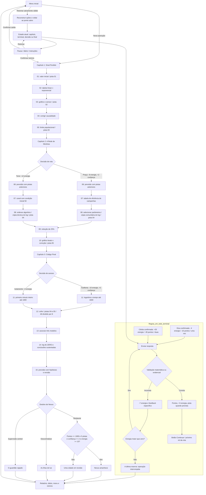

# Fluxograma completo

Cada partida resolve exatamente 15 terminais. Há 18 desafios escritos: os alternativos ocupam as mesmas posições na sequência. As bifurcações retornam à investigação principal depois de desafios e informações específicos.

As decisões têm confirmação: cancelar volta ao ponto anterior. A dica não é cobrada novamente. Resposta já validada não pontua duas vezes. Sem energia, só há relatório/menu/reinício. Salvamento inválido abre o menu e permite iniciar uma nova operação. Nenhuma janela prende o jogador: há botão Fechar e suporte a Esc.
